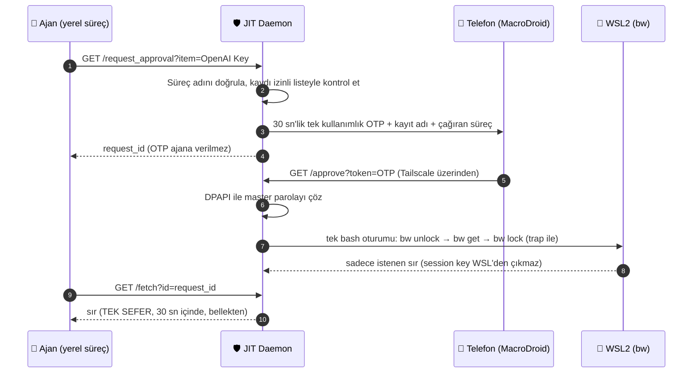

# 🛡️ ZeroTrust-JIT-Bitwarden

Yapay zeka ajanlarına (Claude Code, Cursor, AutoGPT vb.) **kalıcı parola vermeden**, her seferinde **telefondan onay alarak** tek bir Bitwarden kaydını kısa süreliğine teslim eden küçük bir Windows + WSL2 servisi.

> **Durum:** V3.0. Mantık ve bash betiği otomatik testlerle doğrulanıyor (Linux'ta sahte `bw` ile). Gerçek Windows + WSL2 + Bitwarden + MacroDroid zincirinde uçtan uca **henüz denenmedi**; ilk kurulumda `/request_approval` → onay → `/fetch` akışını kendiniz deneyin.

---

## Ne yapar?



1. Ajan yalnızca **izinli listedeki** bir kaydı isteyebilir (`JIT_ALLOWED_ITEMS`).
2. Telefona giden bildirimde kayıt adı ve **daemon'un doğruladığı** çağıran süreç adı yazar. Ajanın yazdığı serbest not ayrıca ve "doğrulanmadı" diye gösterilir.
3. Onay gelmeden sır alınamaz. OTP tek kullanımlıktır; yanlış denemede de yanar.
4. Kasa açıldığı oturumda `trap ... EXIT INT TERM` ile **her durumda** kilitlenir; ayrıca 30 sn'lik watchdog ve kilitleme sonrası doğrulama vardır. Kilitlenemezse sır atılır.
5. Sır diske yazılmaz, komut satırına konmaz, loglanmaz; OTP ve istek kimliği loglardan maskelenir.

---

## Neyi korur, neyi korumaz? (Tehdit modeli)

**Korur:**
- `.env` içine düz metin anahtar koymaya gerek bırakmaz.
- Ajan, telefon onayı olmadan daemon üzerinden sır alamaz.
- Ajan listede olmayan bir kaydı isteyemez; aynı anda tek istek açıktır (OTP ezme / bildirim spamı yok).
- Uzaktan yalnızca Tailscale adreslerinden (100.64.0.0/10) ve yalnızca `/approve` kabul edilir.

**KORUMAZ (bunları bilerek kullanın):**
- **Aynı Windows kullanıcısı = aynı yetki.** DPAPI dosyayı başka kullanıcıdan/bilgisayardan korur, **aynı kullanıcıyla çalışan ajandan korumaz**: ajan dosyayı okuyup master parolayı kendisi çözebilir ve telefon onayını atlar. Gerçek ayrım için:
  - Daemon'u ve `dpapi_setup.ps1`'i ayrı bir Windows kullanıcısıyla (örn. `jitsvc`) çalıştırın, ajanı normal kullanıcıda ya da container/VM'de çalıştırın,
  - `JIT_DPAPI_FILE` ile dosyayı o kullanıcının dizinine koyun.
- **Çağıran süreç listesi zayıf bir filtredir.** `python.exe`/`powershell.exe` zaten ajanların kullandığı süreçlerdir; liste rastgele bir uygulamayı eler, ajanı değil.
- **Ajan sırrı alır.** Tasarım gereği `/fetch` sırrı ajana verir; ajan onu loga yazarsa ya da dışarı gönderirse bu servis engelleyemez. Daha güçlü model: sırrı ajana vermeden daemon'un komutu kendisi çalıştırması ("kör yürütme"); henüz yok.
- **Telefon onayı = bildirimdeki butona basmak.** Biyometrik doğrulama MacroDroid/telefon ayarına bağlıdır, bu kod garanti etmez. Telefon kilitliyken butonun çalışmaması için MacroDroid'de kısıt ekleyin.
- **OTP üçüncü tarafın sunucusundan geçer.** Webhook `trigger.macrodroid.com` üzerinden gider (sadece bildirimi tetikler); onay isteği ise Tailscale üzerinden doğrudan daemon'a gelir. OTP 30 sn geçerli ve tek kullanımlıktır.
- **Bellek:** Parola/sır Python'da `str` olarak kısa süre yaşar; Python'da bellekten güvenle silmek mümkün değil. "RAM dump'a dayanıklı" değildir.
- **WSL'den gelen istekler** (farklı IP'den gelir) reddedilir; ajanı Windows tarafında çalıştırın.
- **GET ile onay:** MacroDroid kolaylığı için `/approve` GET'tir; yalnızca Tailscale'den ve geçerli OTP ile çalışır.

---

## Kurulum

**Gereksinimler:** Windows 10/11, WSL2 (içinde `bw` kurulu ve `bw login` yapılmış), Python 3.10+ (`pip install psutil`), Tailscale (PC + telefon), Android'de MacroDroid.

### 1. Master parolayı DPAPI ile şifrele
Tercihen ajanın çalışmadığı ayrı kullanıcıyla:
```powershell
.\dpapi_setup.ps1                       # varsayılan: %USERPROFILE%\.bw_master_dpapi.txt
.\dpapi_setup.ps1 -Path C:\jit\bw.dpapi # özel yol -> JIT_DPAPI_FILE olarak da ayarlayın
```

### 2. MacroDroid makrosu
- **Tetikleyici:** Webhook, tanımlayıcı `ajan_istek`
- **Eylem 1:** Bildirim göster
  - Başlık: `🛡️ JIT: {v=item}`
  - Metin: `Çağıran: {v=caller} | Ajan notu (doğrulanmadı): {v=note}`
  - Buton `ONAYLA`: HTTP GET → `http://<PC-Tailscale-IP>:5050/approve?token={v=otp}`

Webhook adresini ortam değişkenine yazın (koda yazmayın):
```powershell
setx MACRODROID_WEBHOOK "https://trigger.macrodroid.com/<CIHAZ-ID>/ajan_istek"
```

### 3. Yapılandırma (ortam değişkenleri)
| Değişken | Anlamı | Varsayılan |
| :-- | :-- | :-- |
| `JIT_ALLOWED_ITEMS` | İstenebilecek kayıtlar, virgülle. Ad ya da (tercihen) item UUID'si. `Ad:notes` / `Ad:username` ile alan seçilir. **Boşsa hiçbir sır verilmez.** | boş |
| `JIT_BIND` | Dinlenecek adresler, virgülle. Telefon için Tailscale IP'sini ekleyin: `127.0.0.1,100.x.y.z` | `127.0.0.1` |
| `JIT_PORT` | Port | `5050` |
| `MACRODROID_WEBHOOK` | https webhook adresi | — |
| `JIT_DPAPI_FILE` | DPAPI dosyası yolu | `%USERPROFILE%\.bw_master_dpapi.txt` |
| `JIT_BW_BIN` | WSL içinde `bw` yolu (PATH'te yoksa) | `bw` |

```powershell
setx JIT_ALLOWED_ITEMS "OpenAI Key,Hetzner:notes"
setx JIT_BIND "127.0.0.1,100.101.102.103"
```

### 4. Başlat
```powershell
python jit_server.py
```
Girişte otomatik başlatma (kendi yolunuzu yazın):
```powershell
Set-ItemProperty -Path "HKCU:\Software\Microsoft\Windows\CurrentVersion\Run" `
  -Name "ZeroTrustJITBitwarden" -Value "pythonw.exe `"C:\yol\jit_server.py`""
```
`0.0.0.0` ile dinlemeyin; servis LAN'a açılır.

---

## Ajan tarafı kullanım
```python
import json, time, urllib.request, urllib.error
base = "http://127.0.0.1:5050"
r = json.load(urllib.request.urlopen(f"{base}/request_approval?item=OpenAI%20Key&note=deploy"))
for _ in range(40):                       # telefondan onaylanmasını bekle (en fazla ~30 sn)
    try:
        resp = urllib.request.urlopen(f"{base}/fetch?id={r['request_id']}")
        if resp.status == 200:
            key = resp.read().decode("utf-8")   # TEK SEFER
            break
    except urllib.error.HTTPError as e:          # 404: süre doldu / reddedildi, 502: kasa hatası
        raise SystemExit(f"alınamadı: {e.code}")
    time.sleep(1)
```
`/fetch` durumları: `202` onay bekleniyor · `200` sır (gövde) · `404` yok/süresi doldu/zaten alındı · `502` kasa hatası.
Yardımcı rotalar (yerel): `/status` (bekleyen istek, OTP içermez), `/lock` (acil `bw lock`).

---

## Test ve tarama
```bash
python -m unittest discover -s tests -v        # birim + bash betiği (sahte bw) + HTTP akışı
python scripts/security_and_regression_scan.py # SAST, Zero-File, mimari ve testler
```
Tarayıcı kod yapısını doğrular; gerçek Windows/WSL/telefon zincirini test etmez.

---

## Ajan güvenlik manifestosu
Ajanların uyması gereken 15 madde: [`AGENT_SECURITY_PROTOCOL.md`](AGENT_SECURITY_PROTOCOL.md). Eski blueprint promptu arşivde: [`docs/eski-blueprint-prompt.md`](docs/eski-blueprint-prompt.md).
