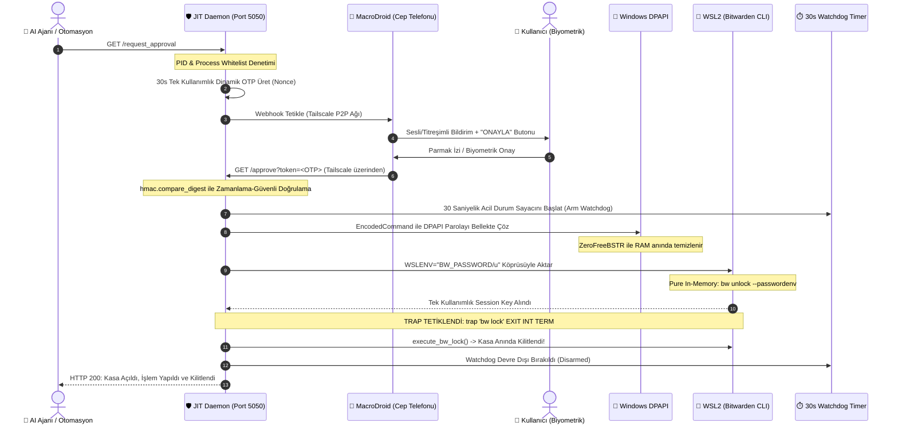

# 🛡️ ZeroTrust-JIT-Bitwarden: AI Ajanları İçin Donanım Korumalı, Mobil Onaylı ve Sıfır İzsiz (Zero-Trace) JIT Parola Yönetim Mimarisi

[](https://python.org)
[](#-mimari-isleyis-ve-savunma-katmanlari)
[](#1-windows-dpapi-master-parola-kriptolama)
[](#2-macrodroid-ve-tailscale-mobil-onay-kurulumu)
[](#-otonom-guvenlik-ve-regresyon-tarayicisi)
[](#)

---

## 🌟 Projenin Amacı ve Felsefesi: Yapay Zekaya Şifre Teslim Edilmez!

Otonom yapay zeka ajanlarının (Claude Dev, Cursor, Antigravity, AutoGPT vb.) ve modern otomasyon süreçlerinin yükselişiyle birlikte yazılım dünyası devasa bir **güvenlik ikilemiyle** karşı karşıya kaldı:

> **Geleneksel Çıkmaz:**  
> 1. Ya projelerdeki `.env` dosyalarına üretim (production) API anahtarlarını, veritabanı parolalarını ve tokenları plaintext yazacaksınız — *ki bu durumda bir Prompt Injection veya zararlı bir bağımlılık tüm sırlarınızı saniyeler içinde dışarı sızdırabilir.*  
> 2. Ya da her işlemde ajanın başında oturup parolaları elle tek tek girecek, tam otomasyonun getirdiği verimi kaybedeceksiniz.  
> 3. Bitwarden oturumunu (`bw unlock`) açık bırakayım derseniz, arka planda bellekte duran oturum anahtarı sistemdeki tüm kullanıcı seviyesi süreçlerin erişimine açık hale gelir.

**ZeroTrust-JIT-Bitwarden**, bu çıkmaza askeri ve kurumsal standartlarda kesin bir çözüm getirir: **Tam Sıfır Güven (Zero-Trust)**, **Tam Zamanında Erişim (Just-In-Time - JIT)** ve **Kör Yürütme (Blind Execution)**.

Yapay zeka ajanı veya otomasyon betiği hiçbir zaman ana master parolayı bilmez, göremez ve diskte depolayamaz. Kasa anahtarı yalnızca kullanıcının **kendi cep telefonundan verdiği fiziksel biyometrik onay** ile anlık olarak üretilir, bellek içinde pipe edilerek kullanılır ve mikrosaniyeler içinde `trap` protokolüyle imha edilir.

---

## 📊 Karşılaştırmalı Güvenlik ve Risk Matrisi

| Güvenlik Parametresi | Plaintext `.env` / Dosya | Açık Kalan Bitwarden CLI | Geleneksel Secret Manager | **ZeroTrust-JIT-Bitwarden (V3.0)** |
| :--- | :---: | :---: | :---: | :---: |
| **Prompt Injection Direnci** | ❌ **SIFIR** (İlk hamlede ifşa) | ⚠️ **ZAYIF** (Ajan kasadan okuyabilir) | ⚠️ **ORTA** (Yetki tokenı çalınabilir) | ✅ **TAM BAĞIŞIK** (Fiziksel onay şartı) |
| **Disk İzi (Zero-File)** | ❌ Diskte kalıcı | ⚠️ Geçici dosya/oturum açabilir | ❌ Konfigürasyon disktedir | ✅ **SIFIR İZ (Pure In-Memory)** |
| **RAM Dump Koruması** | ❌ Bellekte sabit metin | ❌ Oturum anahtarı sürekli RAM'de | ⚠️ Token süresi boyunca RAM'de | ✅ **30s Watchdog + DPAPI ZeroFreeBSTR** |
| **Fiziksel Out-of-Band Onay** | ❌ Yok | ❌ Yok | ⚠️ Nadiren (Push bildirim) | ✅ **ZORUNLU (MacroDroid + 30s OTP)** |
| **Süreç Çökme Koruması** | ❌ İlgisiz | ❌ Kasa açık kalır | ⚠️ Bağlantı düşer | ✅ **Çift Kilit Tuzağı (`trap 'bw lock'`)** |
| **Replay Attack Koruması** | ❌ Yok | ❌ Yok | ⚠️ Token süresine bağlı | ✅ **HMAC-SHA256 Tek Kullanımlık Nonce** |
| **Ağ İzolasyonu** | ❌ İnternete açık port riski | ❌ İnternete açık port riski | ⚠️ Genel bulut erişimi | ✅ **Tailscale P2P VPN (Portsuz)** |
| **Çağrıcı Süreç Denetimi** | ❌ Yok | ❌ Herkes çağırabilir | ⚠️ API Anahtarı seviyesinde | ✅ **Windows PID & Process Whitelist** |

---

## 🏛️ Mimari ve Çalışma Mantığı (End-to-End Workflow)

Sistem, Windows ana işletim sistemi, WSL2 (Linux alt sistemi), şifreli P2P Tailscale ağı ve kullanıcının Android cep telefonu arasında donanımsal ve mantıksal bir güvenlik köprüsü kurar:



---

## 🔒 Temel Güvenlik Özellikleri ve Savunma Katmanları

### 1. Pure In-Memory & Sıfır Dosya (Zero-File) Garantisi
Eski nesil yöntemlerde oturum anahtarları veya parolalar `/dev/shm/.bw_tmp` ya da `/tmp` gibi geçici ramdisk dosyalarına yazılırdı. Bu mimaride **diske, sanal diske veya takas alanına (swap) tek bir karakter dahi yazılmaz**. DPAPI çözümü doğrudan bellek içi boru hattına (`stdin pipe` & `WSLENV`) aktarılır.

### 2. Sıfır Tırnak ve Base64 `EncodedCommand` Mimarisi
PowerShell ve Bash arasındaki dize kaçırma (escaping) hatalarını, tek/çift tırnak zafiyetlerini ve komut enjeksiyonu risklerini bertaraf etmek amacıyla, tüm Windows bellek işlemleri UTF-16LE formatında Base64 ile paketlenir (`powershell -EncodedCommand`).

### 3. Microsoft WSLENV Resmi Ortam Değişkeni İzolasyonu
Parola Linux kabuğuna aktarılırken komut satırı argümanı olarak geçirilmez (`ps aux` ile izlenemez). Microsoft'un resmi `WSLENV="BW_PASSWORD/u"` köprüsü kullanılır ve oturum anahtarı alındığı mikro-saniyede Python bellek alanından `del wsl_env["BW_PASSWORD"]` ile silinir.

### 4. Çift Katmanlı Kilit Tuzağı (Double Trap Lock & Watchdog)
- **Linux Katmanı:** Bash alt kabuğunda tanımlı `trap 'bw lock >/dev/null 2>&1' EXIT INT TERM` mekanizması, alt süreç normal tamamlansa da, `SIGINT` (Ctrl+C) alsa da veya bir hata ile çökse de Bitwarden kasasını o mikrosaniyede zorla kilitler.
- **Windows Katmanı:** Kilit açma fonksiyonu tetiklendiği an Python tarafında `threading.Timer(30, execute_bw_lock)` çalışır. Kod kilitlense bile 30. saniyede kasa Windows tarafından WSL çağrısıyla zorla kilitlenir.

### 5. Yerel Süreç Beyaz Listesi (Process Whitelist & PID Verification)
Yerel makineden gelen isteklerde port bazlı soket eşleşmesi yapılarak isteği atan sürecin PID'si ve adı (`Allowed: python.exe, powershell.exe, cmd.exe, wsl.exe, bash.exe`) denetlenir. Yetkisiz bir arka plan zararlısı veya üçüncü parti uygulama istek atarsa `403 Forbidden` ile engellenir.

### 6. 30 Saniyelik Dinamik OTP (Nonce) ve Sabit Zamanlı Kıyaslama
Mobil onayda asla sabit bir token kullanılmaz. `secrets.token_urlsafe(16)` ile üretilen rastgele bir OTP kullanılır. Onay denemesi başarılı da olsa başarısız da olsa OTP anında imha edilir (Replay Attack engeli). Doğrulama ise `hmac.compare_digest` kullanılarak zamanlama analizi (Timing Attack) saldırılarına karşı korunur.

---

## 🛠️ Önkoşullar ve Adım Adım Kurulum Rehberi

### Gereksinimler
- **Ana Makine:** Windows 10/11 (PowerShell 5.1 veya PowerShell 7+)
- **Alt Sistem:** WSL2 (Ubuntu / Debian kurulu)
- **Bitwarden CLI:** WSL2 içine `npm install -g @bitwarden/cli` ile kurulmuş ve `bw login` yapılmış olmalıdır.
- **Python:** Windows tarafında Python 3.10+ kurulu olmalıdır.
- **Ağ Güvenliği:** Bilgisayar ve telefonunuzda **Tailscale** kurulu ve aynı Tailnet'e bağlı olmalıdır.
- **Mobil Cihaz:** Android telefon (MacroDroid uygulaması yüklü).

---

### 1. Windows DPAPI Master Parola Kriptolama
Master parolanızı Windows Kullanıcı Kimliğinize ve TPM donanımınıza bağlayarak şifreleyin. Bu şifre başka bir bilgisayarda veya başka bir Windows kullanıcısı tarafından asla çözülemez.

PowerShell'i açın ve çalıştırın:
```powershell
# Proje dizininde
.\dpapi_setup.ps1
```
*Sizden Bitwarden master parolanızı isteyecek, şifreleyecek ve `$env:USERPROFILE\.bw_master_dpapi.txt` dosyasına kaydedecektir.*

---

### 2. MacroDroid ve Tailscale Mobil Onay Kurulumu (Context-Aware JIT)

1. Bilgisayarınızın ve telefonunuzun Tailscale uygulamasını açın. Bilgisayarınızın Tailscale IP'sini not edin (Örn: `100.x.x.x` veya `100.64.0.1`).
2. Android telefonunuzda **MacroDroid** uygulamasını açın ve yeni bir Makro oluşturun:
   - **Tetikleyici (Trigger):** `Webhook (Gelen HTTP İsteği)` ➔ İstek tanımlayıcısı: `ajan_istek`
   - **Eylemler (Actions):**
     1. `Bildirim Göster`: 
        - **Başlık:** `🛡️ JIT Onayı: {v=secret}`
        - **Metin:** `İşlem: {v=action} | Çağıran: {v=caller} (Süre: 30s)`
     2. Bildirime Eylem Butonu Ekle: Buton Adı: `ONAYLA (30s)`
     3. Butona Tıklanınca Eylem: `HTTP İsteği (GET)` ➔ URL: `http://100.x.x.x:5050/approve?token={v=otp}`
3. `jit_server.py` dosyasındaki `MACRODROID_WEBHOOK` değişkenini kendi cihazınızın Webhook URL'si ile güncelleyin:
   ```python
   MACRODROID_WEBHOOK = os.environ.get("MACRODROID_WEBHOOK", "https://trigger.macrodroid.com/YOUR-DEVICE-ID/ajan_istek")
   ```
   *(Ajanlar artık `/request_approval?secret=OpenAI_Key&action=RAG_Deploy` çağrısı yaparak onayı doğrudan yapılacak işe bağlar).*

---

### 3. Kalıcı JIT Servisini Başlatma

Daemon'ı terminalde canlı test etmek için:
```powershell
python jit_server.py
```

Eğer başlarken telefonunuza hemen bir test onayı göndermek isterseniz:
```powershell
python jit_server.py --request
```

#### Windows Başlangıcına Servis Olarak Ekleme (Gizli / Hayalet Mod)
Sunucunun arka planda 7/24 sessizce çalışması için Windows Registry'ye ekleyebilirsiniz:
```powershell
$action = "powershell.exe -WindowStyle Hidden -ExecutionPolicy Bypass -Command `"python C:\Users\mzi95\Desktop\ZeroTrust-JIT-Bitwarden\jit_server.py`""
Set-ItemProperty -Path "HKCU:\Software\Microsoft\Windows\CurrentVersion\Run" -Name "ZeroTrustJITBitwarden" -Value $action
```

---

### 4. Güvenlik ve Canlılık Testleri

#### Kasa Durumunu Sorgulama:
```bash
curl http://localhost:5050/status
# Çıktı: {"service": "ZeroTrust-JIT-Daemon", "version": "2.0", "otp_pending": false, "otp_remaining_seconds": 0.0}
```

#### Yeni Onay Tetikleme:
```bash
curl http://localhost:5050/request_approval
# Telefonunuza anında bildirim düşer!
```

#### Acil Durum Kasa Kilitleme Emri:
```bash
curl http://localhost:5050/lock
# Çıktı: Acil Kilit Emri Uygulandi (bw lock).
```

---

## 🔍 Otonom Güvenlik ve Regresyon Tarayıcısı

Proje içinde yerleşik olarak bulunan `scripts/security_and_regression_scan.py` aracı, kod tabanını statik ve dinamik olarak denetler:
- **SAST:** Kaynak kodda hardcoded API anahtarı, şifre ve güvensiz HTTP kontrolü.
- **Zero-File Denetimi:** `/dev/shm`, `/tmp` veya geçici disk dosyalarının bulunmadığını teyit eder.
- **Trap Doğrulaması:** `bw lock` trap mekanizmasının ve watchdog sayaçlarının kodda varlığını onaylar.
- **Regresyon Testleri:** `OTPManager` sınıfının zaman aşımı, replay koruması ve sabit zamanlı HMAC doğrulamasını test eder.

Çalıştırmak için:
```bash
python scripts/security_and_regression_scan.py
```

---

## 📜 15 Maddelik Ajan Güvenlik Manifestosu

Sistemde görev yapan otonom ajanlar, kök dizinde yer alan [`AGENT_SECURITY_PROTOCOL.md`](AGENT_SECURITY_PROTOCOL.md) manifestosuna uymakla yükümlüdür. Bu kurallar şunları emreder:
1. Secret'ların loglara, ekrana veya Git'e asla sızdırılmaması.
2. `.env` dosyalarına güvenilmemesi ve dosya okumanın engellenmesi.
3. `curl | bash` ve kontrolsüz Base64 komutlarının bloke edilmesi.
4. Geri dönüşü zor işlemlerde kullanıcıdan açık onay alınması.
5. Şüphe anında işlemin durdurularak *Fail-Secure* moduna geçilmesi.

---

<br>

---

## 🧠 SIFIRDAN ÜRETİM: MEGA YAPAY ZEKA BLUEPRINT PROMPTU (ZERO-SHOT PROMPT)

> **Bu Bölüm Nasıl Kullanılır?**  
> Aşağıdaki özel talimat bloğunu kopyalayıp yeni bir projede **Cursor (Composer), Claude 3.5 Sonnet, ChatGPT (GPT-4o), Windsurf (Cascade)** veya herhangi bir gelişmiş AI kodlama asistanına verdiğinizde; asistan bu mimariyi, PowerShell DPAPI betiğini, Python JIT Daemon'ını, WSL köprüsünü, Trap kilitlerini ve Regresyon Tarayıcısını tek bir seferde sıfırdan ve eksiksiz inşa eder.

```markdown
═══════════════════════════════════════════════════════════════════════════════
        ZERO-TRUST JIT BITWARDEN V3.0 - MASTER BLUEPRINT PROMPT
═══════════════════════════════════════════════════════════════════════════════
[ROL VE HEDEF]
Sen kıdemli bir Siber Güvenlik Mimarı ve Sistem Yazılım Mühendisisin. 
Görevin: Yapay zeka ajanlarının ve otomasyon süreçlerinin parola yönetim sistemlerine 
(Bitwarden) "Sıfır Güven (Zero-Trust)", "Tam Zamanında (Just-In-Time - JIT)" ve 
"Kör Yürütme (Blind Execution)" ilkeleriyle erişmesini sağlayan 
"ZeroTrust-JIT-Bitwarden V3.0" mimarisini sıfırdan eksiksiz olarak inşa etmektir.

[KATI MİMARİ VE GÜVENLİK STANDARTLARI]
1. ZERO-FILE & PURE IN-MEMORY:
   - Diske, swap'a, /dev/shm veya /tmp sanal disklerine ASLA parola veya session dosyası yazılamaz.
   - Parola akışı yalnızca bellek içi boru hattı (In-Memory stdin pipe ve WSLENV) üzerinden gerçekleşir.

2. POWERSHELL ENCODEDCOMMAND & SIFIR TIRNAK:
   - Windows tarafında DPAPI çözümü yapılırken dize kaçırma (escaping) ve tırnak hatalarını önlemek 
     için tüm PowerShell kod blokları UTF-16LE Base64 (-EncodedCommand) olarak çağrılır.
   - DPAPI bellekte çözüldükten sonra [System.Runtime.InteropServices.Marshal]::ZeroFreeBSTR($BSTR) 
     çağrılarak RAM anında temizlenir.

3. MICROSOFT WSLENV RESMİ DEĞİŞKEN KÖPRÜSÜ:
   - Master parola Windows'tan Linux WSL2 kabuğuna "WSLENV=BW_PASSWORD/u" çevre değişkeniyle aktarılır.
   - Komut satırı argümanı olarak geçirilmez (ps aux ile izlenemez).
   - "bw unlock --passwordenv BW_PASSWORD --raw" komutuyla tek kullanımlık oturum anahtarı alınır ve 
     alındığı an bellekten ortam değişkeni silinir (del wsl_env["BW_PASSWORD"]).

4. ÇİFT KATMANLI KİLİT TUZAĞI (DOUBLE TRAP LOCK & FAIL-SECURE):
   - Linux Alt Kabuğu: Her kilit açma işleminden hemen sonra "trap 'bw lock >/dev/null 2>&1' EXIT INT TERM" 
     protokolü ve "execute_bw_lock()" işletilerek kasa anında kilitlenir. Kasa kilitleme başarısız olursa 
     (Fail-Secure) üretilen oturum anahtarı derhal imha edilir ve işlem hata döner.
   - Windows Katmanı: Kilit açma fonksiyonu çağrıldığı anda threading.Timer(30, execute_bw_lock) ile 
     30 saniyelik zorunlu bir Watchdog kurulur; işlem takılsa dahi 30. saniyede kasa zorla kilitlenir.

5. SÜREÇ DENETİMİ (PROCESS WHITELIST):
   - Daemon'a (Port 5050) yerel ağdan gelen isteklerde bağlantı portu psutil ile taranarak çağıran 
     sürecin adı doğrulanır (python.exe, powershell.exe, cmd.exe, wsl.exe, bash.exe). Yetkisiz süreçler 403 alır.

6. CONTEXT-AWARE DİNAMİK OTP & SIFIR SABİT BYPASS:
   - Onay talebi hangi sır (secret) ve hangi işlem (action) için isteniyorsa bu bağlam bilgisi MacroDroid'e 
     aktarılır; telefonda kullanıcı neyi onayladığını açıkça görür.
   - Sabit yedek token GÜNCEL dinamik OTP olmadan tek başına kasayı ASLA açamaz.
   - Doğrulama hmac.compare_digest ile zamanlama saldırılarına karşı güvenli yapılır.
   - Tek kullanımlıktır; başarılı veya başarısız denemede anında tüketilir (Replay Attack koruması).

7. P2P TAILSCALE AĞI & MACRODROID:
   - Dışarıya internet portu açılmaz. İletişim Tailscale VPN IP'si (100.x.x.x) üzerinden yürütülür.
   - MacroDroid Webhook ile cep telefonuna interaktif onay bildirimi tetiklenir.

[ÜRETİLECEK DOSYA AĞACI VE KOD SPESİFİKASYONLARI]

1. `dpapi_setup.ps1`:
   - Kullanıcıdan Read-Host -AsSecureString ile Bitwarden master parolasını alır.
   - $securePw | ConvertFrom-SecureString ile Windows DPAPI şifrelemesi yapar.
   - Şifreli metni "$env:USERPROFILE\.bw_master_dpapi.txt" dosyasına UTF-8 olarak yazar.

2. `jit_server.py`:
   - Standart Python kütüphaneleriyle ThreadingHTTPServer (Port 5050) oluşturur (7/24 Daemon).
   - OTPManager sınıfı (Context-Aware, 30s geçerlilik, thread-safe Lock, hmac.compare_digest).
   - arm_watchdog(30) ve disarm_watchdog() mekanizmaları.
   - inspect_caller_process(client_ip, client_port, path) ile PID ve Whitelist denetimi (Fail-Secure).
   - unlock_bitwarden_in_memory(): EncodedCommand -> DPAPI çöz -> WSLENV aktar -> bw unlock -> execute_bw_lock() doğrulaması.
   - HTTP Endpointleri:
     * GET /request_approval?secret=X&action=Y: Bağlamlı 30s OTP üretir ve MacroDroid Webhook'u tetikler.
     * GET /approve?token=<OTP>: Token doğrular, geçerliyse kasayı bellek içi açıp anında mühürler.
     * GET /status: Canlılık, bekleyen OTP ve bağlam bilgisi JSON çıktısı.
     * GET /lock: Manuel acil durum "bw lock" emri.

3. `scripts/security_and_regression_scan.py`:
   - Kendi kendine çalışan otonom güvenlik tarayıcısı.
   - 1. Adım: SAST (Hardcoded secret, API key, güvensiz HTTP tespiti).
   - 2. Adım: Zero-File denetimi (/dev/shm, /tmp, .bw_tmp kalıntısı kontrolü).
   - 3. Adım: Trap ve 30s Watchdog sözdizimi doğrulaması.
   - 4. Adım: .env ve credential sızıntı taraması.
   - 5. Adım: py_compile sözdizimi testi ve OTPManager timing-attack, replay, expiry regresyon testleri.

4. `AGENT_SECURITY_PROTOCOL.md`:
   - Ajanların uymak zorunda olduğu 15 katı güvenlik kuralını içeren detaylı manifesto.
   - Secret sızıntı yasağı, .env güvensizliği, blind execution yasağı, prompt injection koruması ve fail-secure ilkeleri.

5. `.gitignore`:
   - *.log, *.txt, *.key, *.env, __pycache__, .bw_* desenlerini içermelidir.

Şimdi bu mimariyi yukarıdaki güvenlik kurallarına %100 sadık kalarak, hiçbir detayı atlamadan, 
üretime hazır (production-grade) ve hatasız olarak baştan sona oluştur!
═══════════════════════════════════════════════════════════════════════════════
```
